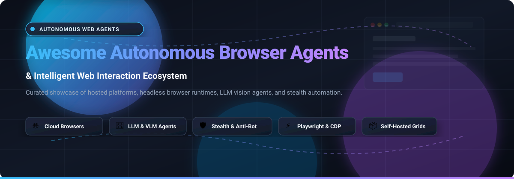

  

# 🌐 Awesome Autonomous Browser Agents & Web Interaction 🤖

  
  
  
  
  

---

## 🎯 Overview & Scope

A curated, comprehensive showcase and index of **Autonomous Browser Agents**, **Headless Cloud Browsers**, and **Web Interaction Frameworks**. These tools navigate the dynamic web, parse Document Object Models (DOM) and accessibility trees, visually interpret web user interfaces (VLM), bypass anti-bot and CAPTCHA mechanisms, and execute multi-step automations across SaaS applications, eCommerce, and enterprise platforms.

Whether you are building autonomous AI agents with frameworks like LangChain, LlamaIndex, or AutoGen, scaling headless Playwright/Puppeteer browser grids in Docker, or developing resilient data extraction pipelines, this directory compiles the industry's premier SaaS platforms and open-source GitHub repositories.

---

## 📑 Table of Contents

- [📊 Sector Overview & Market Dynamics](#-sector-overview--market-dynamics)
- [☁️ SaaS & Hosted Platforms](#️-saas--hosted-platforms)
- [🔓 Open-Source GitHub Projects](#-open-source-github-projects)
- [🛠️ Key Framework Architectures](#️-key-framework-architectures)
- [🤝 How to Contribute](#-how-to-contribute)
- [☕ Support & Share](#-support--share)
- [📈 Star History](#-star-history)
- [⚠️ Disclaimer](#️-disclaimer)

---

## 📊 Sector Overview & Market Dynamics

The autonomous browser agent and intelligent web automation sector represents an estimated market size of **$6B to $10B** (expanding rapidly toward **$70B+ by 2030** with an anticipated Compound Annual Growth Rate exceeding **35–45%**), bridging foundational LLM reasoning, computer vision action models, cloud infrastructure, and enterprise robotic process automation (RPA). 

The market dynamics reflect a **moderately to highly fragmented structure** rather than a winner-take-all monopoly:
- **The "Brittle Web" Challenge:** Websites continuously revise DOM structures, roll out advanced bot-detection algorithms (Cloudflare Turnstile, DataDome, Akamai), and deploy dynamic single-page applications. No single platform has achieved 100% reliability across every web surface.
- **Divergent Developer Requirements:** Some teams require low-latency cloud sandboxes with residential IP proxies, while others build localized agentic workflows requiring fully auditable, on-premise open-source browser runtimes.
- **Ecosystem Coexistence:** Major hyperscalers (such as Microsoft Azure with Playwright Testing) coexist with agile, venture-backed startups (Browserbase, MultiOn, Hyperbrowser) and hyper-popular open-source repositories (Browser Use, Firecrawl, Crawl4AI, OpenHands).

---

## ☁️ SaaS & Hosted Platforms

Managed browser execution infrastructure, cloud agent runtimes, and headless scraping APIs with automated session management, proxy rotation, and CAPTCHA handling.

| Platform | 🏢 Estimated Scale / Valuation / Revenue | 💳 Starting Pricing Tier | 🎁 Free Tier Limits | 📝 Description |
| :--- | :--- | :--- | :--- | :--- |
| **[Playwright Cloud (Microsoft Playwright Testing)](https://playwright.dev)** | **~$3.1 Trillion** market cap (Microsoft) / Enterprise hyperscaler | **$0.01 / test-minute** (Linux pay-as-you-go; $0.02 / test-min on Windows) | **30-day free trial** with **100 browser test minutes** (1 workspace limit per Azure subscription) | Managed cloud browser execution infrastructure providing high-concurrency end-to-end testing and multi-browser execution across Chromium, Firefox, and WebKit. |
| **[Browserbase](https://browserbase.com)** | **$300M valuation** (Series B) / **~$3.6M+ ARR** | **$20/mo** (Developer Plan; overages at $0.12/browser hr) | **Free plan ($0/mo)**: 1 browser hour/mo, 3 concurrent sessions (max 15 min/session), 3 agent runs, and 1,000 fetch/search calls | Cloud serverless headless browser infrastructure built specifically for AI agents, featuring session replay, residential proxies, and auto-CAPTCHA solving. |
| **[MultiOn](https://multion.ai)** | **$100M valuation** (Series A, backed by Amazon & General Catalyst) | **$20/mo** (Pro Tier) | **Free plan ($0/mo)**: Limited baseline credits/month for light personal browsing and developer task testing | Cloud-hosted personal and enterprise AI web agent API capable of autonomously browsing websites, interacting with complex UIs, and executing multi-step tasks. |
| **[Zyte](https://zyte.com)** | **~$25M ARR** / Bootstrapped & $3M venture debt | **$0.13 / 1,000 requests** (Pay-As-You-Go; optional $100/mo commitment tier) | **30-day free trial** with **$5 one-time credit** (covers automated ban handling and browser-rendered extraction) | Enterprise cloud web data extraction platform combining AI-powered automated parsing, headless browser rendering, and smart proxy management. |
| **[ScrapingBee](https://scrapingbee.com)** | **~$10M+ acquisition** (Acquired by Oxylabs) / **~$5M ARR** | **$19/mo** (Hobby Plan with 25,000 credits) | **One-time free trial**: **1,000 API credits** (no time limit, no credit card required) | Managed headless Chrome API handling proxy rotation, dynamic JavaScript rendering, and structured data extraction for web agents and scrapers. |
| **[Apify](https://apify.com)** | **~$7.5M+ ARR** / $3.5M funding | **$19/mo** (Starter Plan; includes $19 platform credits) | **Free plan ($0/mo)**: **$5 monthly recurring credit**, 16 GB max RAM, 5 concurrent runs, and 5 datacenter proxies | Cloud web scraping and browser automation platform offering serverless Actors, proxy rotation, and pre-built AI web-browsing integrations. |
| **[Scrapfly](https://scrapfly.io)** | **Bootstrapped / ~$1M–$3M estimated ARR** | **$30/mo** (Discovery Plan with 200,000 credits) | **Free plan ($0/mo)**: **1,000 credits** (no expiration, 5 concurrent requests, all 5 APIs enabled) | Cloud web scraping and headless browser API featuring anti-bot bypass, residential proxies, JavaScript rendering, and LLM-ready Markdown extraction. |
| **[Hyperbrowser](https://hyperbrowser.ai)** | **Early-stage venture-backed** (Y Combinator, Accel, SV Angel) | **$30/mo** (Startup Plan with 30,000 credits) | **Free plan ($0/mo)**: **5,000 initial credits**, 1 concurrent browser session, and 7-day data retention | Managed cloud browser platform engineered for scaling AI browser agents, parallel Playwright/Puppeteer sessions, and structured web data extraction. |
| **[Steel.dev (Hosted Cloud)](https://steel.dev)** | **Early-stage seed startup** (Creator of open-source Steel) | **$0.10 / browser hr** (Pay-as-you-go after trial) | **Launch plan ($0/mo)**: **$30 one-time credit** (~300 browser hrs), up to 10 concurrent browsers (15 min/session) | Managed cloud edition of the open-source Steel browser API providing stateful, sandboxed headless browser sessions for autonomous AI agents. |

---

## 🔓 Open-Source GitHub Projects

Curated open-source repositories for autonomous browsing, AI agent execution, headless browser grids, accessibility parsing, and stealth web automation — sorted in descending order by GitHub_Stars.

- **[Firecrawl (`mendableai/firecrawl`)](https://github.com/mendableai/firecrawl)**   
  🔥 Turn entire websites into clean, LLM-ready markdown or structured data with crawl, scrape, map, and extract endpoints designed for AI agent knowledge ingestion.

- **[Browser Use (`browser-use/browser-use`)](https://github.com/browser-use/browser-use)**   
  🤖 Leading open-source Python library connecting Large Language Models (LLMs) and Vision-Language Models (VLMs) with Playwright to autonomously navigate websites, fill forms, and operate web UIs.

- **[Playwright (`microsoft/playwright`)](https://github.com/microsoft/playwright)**   
  ⚡ Foundational cross-browser automation framework across Chromium, Firefox, and WebKit with native CDP support, auto-waiting, and rock-solid execution powering modern AI web agents.

- **[Puppeteer (`puppeteer/puppeteer`)](https://github.com/puppeteer/puppeteer)**   
  🎭 Node.js library providing a high-level API to control Chrome and Chromium over the Chrome DevTools Protocol (CDP), widely used for headless browser automation and screenshot capture.

- **[OpenHands (`All-Hands-AI/OpenHands`)](https://github.com/All-Hands-AI/OpenHands)**   
  👐 Autonomous AI software development and computer/browser agent platform capable of executing terminal commands, modifying code, and interacting with browsers to solve complex end-to-end tasks.

- **[Crawl4AI (`unclecode/crawl4ai`)](https://github.com/unclecode/crawl4ai)**   
  🕷️ High-performance open-source asynchronous web crawler and data scraper engineered for LLMs, generating clean Markdown, semantic chunks, and structured JSON output.

- **[Open Interpreter (`OpenInterpreter/open-interpreter`)](https://github.com/OpenInterpreter/open-interpreter)**   
  💻 Natural-language computer interface allowing LLMs to run Python, JavaScript, and shell commands locally, including automated browser navigation and UI interaction.

- **[Crawlee (`apify/crawlee`)](https://github.com/apify/crawlee)**   
  🛡️ Enterprise-grade web scraping and browser automation library for Node.js and Python with built-in browser fingerprint spoofing, proxy rotation, and session management.

- **[Stagehand (`browserbase/stagehand`)](https://github.com/browserbase/stagehand)**   
  🖐️ AI web browsing SDK built on Playwright combining deterministic TypeScript/Python code with natural-language `act`, `extract`, and `observe` agent primitives.

- **[Skyvern (`Skyvern-AI/skyvern`)](https://github.com/Skyvern-AI/skyvern)**   
  🦅 Vision-and-LLM-driven browser automation agent navigating dynamic, unfamiliar websites and automating complex multi-step workflows without brittle CSS or XPath selectors.

- **[Midscene.js (`web-infra-dev/midscene`)](https://github.com/web-infra-dev/midscene)**   
  🎬 Vision-Language Model (VLM) powered UI automation tool and Chrome extension for natural-language web interactions, automated assertions, and end-to-end testing.

- **[Browserless (`browserless/browserless`)](https://github.com/browserless/browserless)**   
  🐳 Robust open-source Docker service for running, scaling, and managing headless Chrome instances over WebSockets and REST APIs for scalable browser grids.

- **[Camoufox (`daijro/camoufox`)](https://github.com/daijro/camoufox)**   
  🦊 Specialized anti-detect headless browser based on Firefox, spoofing human browser fingerprints and resisting sophisticated bot detection without WebDriver signatures.

- **[Agent-S (`simular-ai/Agent-S`)](https://github.com/simular-ai/Agent-S)**   
  🧠 Open-source Computer-Using Agent (CUA) framework with hierarchical planning and multimodal experience learning for autonomous GUI and browser task execution.

- **[Microsoft UFO (`microsoft/UFO`)](https://github.com/microsoft/UFO)**   
  🛸 Dual-agent UI-focused framework from Microsoft tailored for seamlessly interacting with Windows desktop applications and web browser clients.

- **[Steel (`steel-dev/steel-browser`)](https://github.com/steel-dev/steel-browser)**   
  🔩 Open-source, self-hostable headless browser sandbox and session API engineered specifically for AI agents with persistent storage, extension injection, and devtools.

- **[LaVague (`lavague-ai/LaVague`)](https://github.com/lavague-ai/LaVague)**   
  🌊 Large Action Model (LAM) framework combining World Models and Action Engines to compile natural-language user objectives into deterministic Playwright browser actions.

- **[Nodriver (`ultrafunkamsterdam/nodriver`)](https://github.com/ultrafunkamsterdam/nodriver)**   
  🚗 High-performance asynchronous Python web scraping and automation framework communicating directly via CDP without Selenium WebDriver footprints.

- **[Computer Use OOTB (`showlab/Computer_Use_OOTB`)](https://github.com/showlab/Computer_Use_OOTB)**   
  📦 Out-of-the-box GUI and browser automation solution based on Anthropic's Computer Use API, featuring customized web interfaces and multi-OS support.

- **[WebArena (`web-arena-x/webarena`)](https://github.com/web-arena-x/webarena)**   
  🏟️ Realistic, standalone web evaluation environment and reproducible benchmark measuring autonomous agent task completion across e-commerce, forums, and developer platforms.

- **[AutoWebGLM (`THUDM/AutoWebGLM`)](https://github.com/THUDM/AutoWebGLM)**   
  🤖 Autonomous web navigation and reasoning agent based on ChatGLM, incorporating curriculum learning and reinforcement learning for browser browsing.

- **[VisualWebArena (`web-arena-x/visualwebarena`)](https://github.com/web-arena-x/visualwebarena)**   
  👁️ Multimodal benchmark suite evaluating multimodal web agents on complex visual navigation, dynamic layout comprehension, and graphic web applications.

---

## 🛠️ Key Framework Architectures

For engineering resilient custom autonomous browser systems, developers frequently combine these complementary layers:
- **Sandbox Infrastructure:** Deploy **[Steel](https://github.com/steel-dev/steel-browser)** or **[Browserless](https://github.com/browserless/browserless)** in Docker for isolated multi-tenant browser runtimes.
- **Agent Orchestration:** Use **[Browser Use](https://github.com/browser-use/browser-use)** or **[Stagehand](https://github.com/browserbase/stagehand)** to translate high-level LLM goals into robust DOM clicks, typing, and state validations.
- **Stealth & Anti-Bot Defense:** Integrate **[Camoufox](https://github.com/daijro/camoufox)** or **[Crawlee](https://github.com/apify/crawlee)** to spoof browser fingerprints and rotate residential proxies without triggering CAPTCHAs.
- **LLM Data Extraction:** Utilize **[Crawl4AI](https://github.com/unclecode/crawl4ai)** or **[Firecrawl](https://github.com/mendableai/firecrawl)** to convert dynamic client-rendered JavaScript into clean, structured Markdown for token-efficient RAG ingestion.

---

## 🤝 How to Contribute

Contributions are warmly welcomed! Help expand this directory by submitting pull requests:

1. 🍴 **Fork the repository**.
2. 🌿 **Create a descriptive feature branch** (`git checkout -b add-my-agent-tool`).
3. 📝 **Add or update an entry** in `README.md` following the established table or open-source list format. Include:
   - Tool Name and hyperlinked repository URL.
   - GitHub_Stars_Badge formatted as: ``.
   - Concise 1–2 sentence description highlighting technical capabilities.
4. 🚀 **Submit a Pull Request** with a clear explanation of why the tool is beneficial to autonomous browser agent developers.

---

## ☕ Support & Share

If this curated repository assists your research, workflow, or AI agent applications, please consider supporting the project:

- ⭐ **Star this repository** to help other developers and researchers discover it.
- 🍴 **Fork & Share** it with your engineering team, communities, or on social platforms.
- 💖 **Sponsor / Buy me a coffee**: Your sponsorship directly supports continuous curation, benchmarking, and maintaining open-source toolkits. Check out the [GitHub Sponsor Dashboard](https://github.com/sponsors/ishandutta2007) for special badges, project shoutouts, and prioritized issue assistance!

  

---

## 📈 Star History

---

## ⚠️ Disclaimer

- This repository is a **community-curated directory** provided for educational, research, and developer enablement purposes; inclusion does not constitute commercial endorsement.
- Autonomous browser agents interacting with live third-party websites must adhere to applicable terms of service, platform policies, `robots.txt` guidelines, and data protection privacy regulations.
- Exercise caution never to transmit sensitive credentials, payment details, or personal session tokens to unvetted prompt pipelines or public execution sandboxes.

---

  <b>Crafted with care for AI agent builders, QA automation specialists, data engineers, and the open-source web ecosystem.</b>

